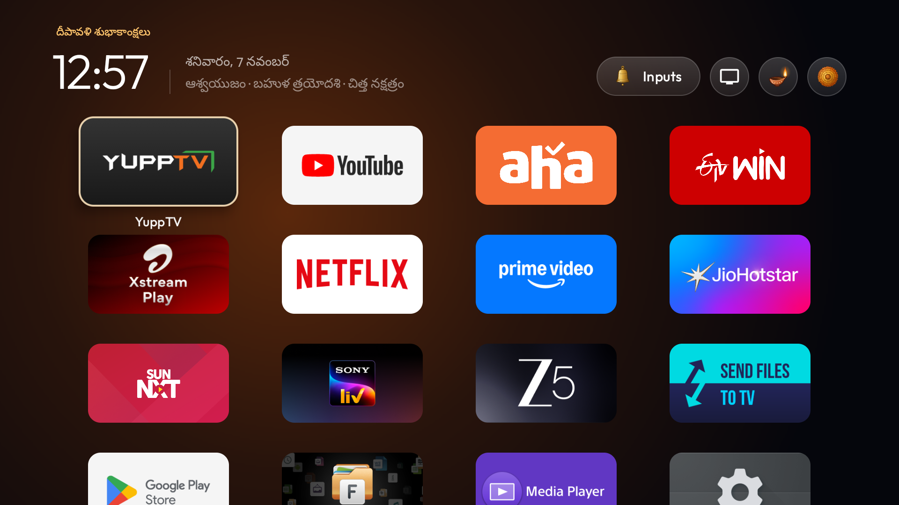
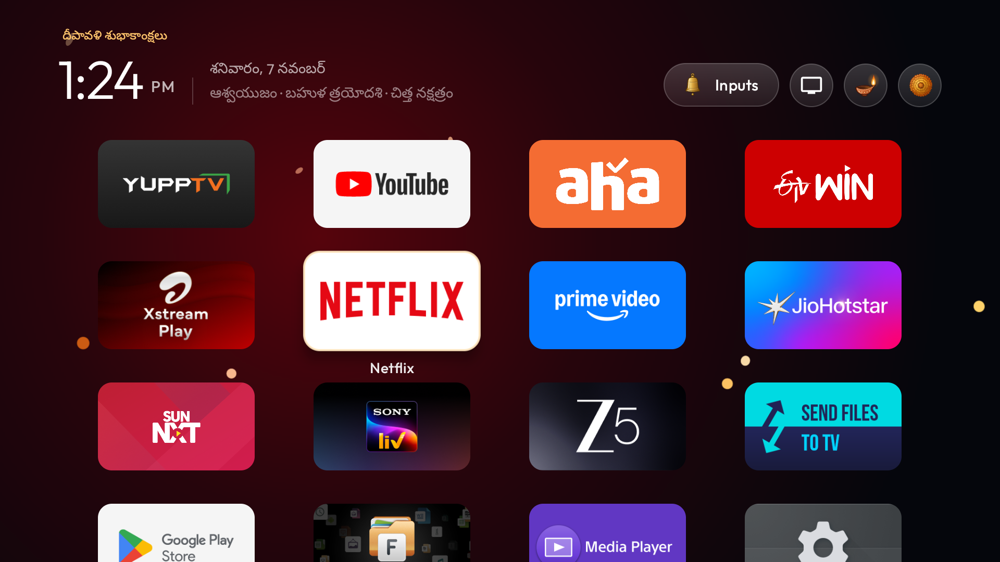
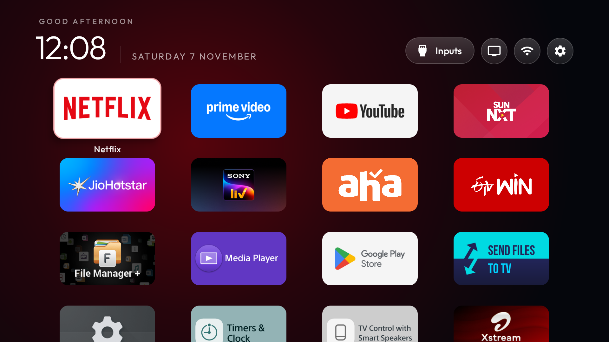
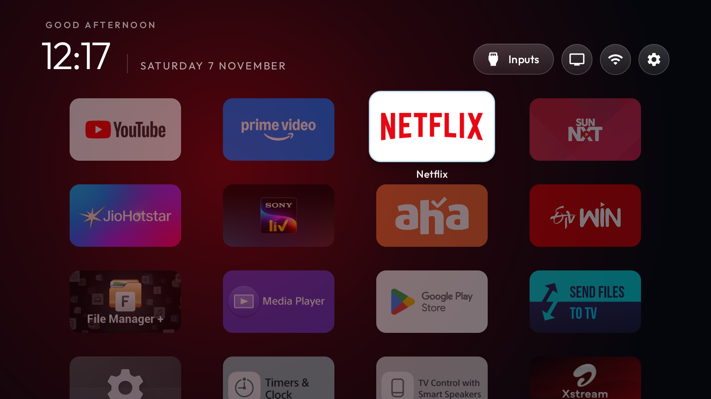
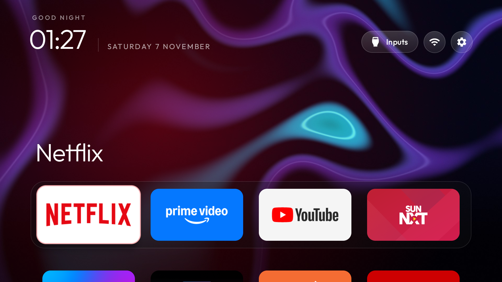
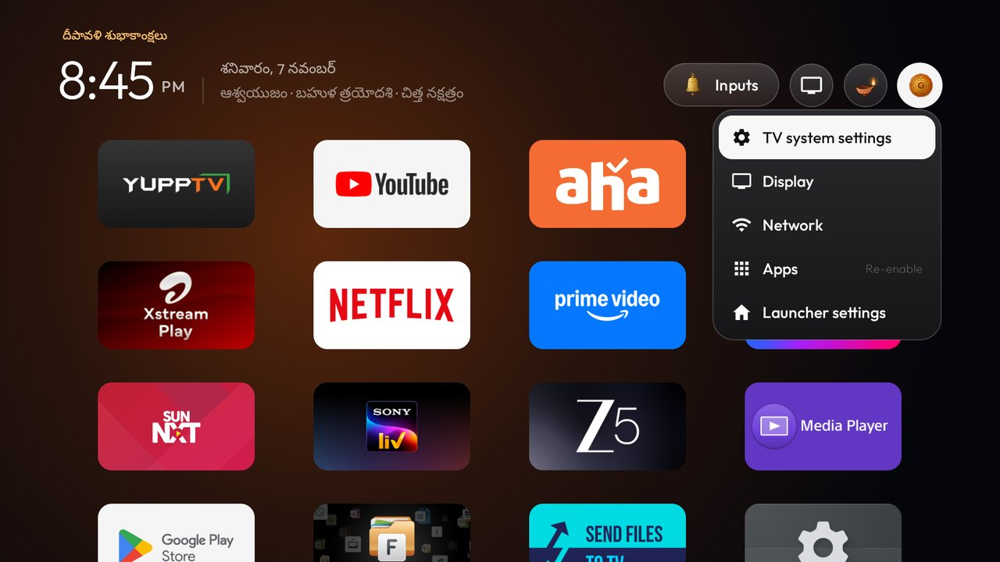
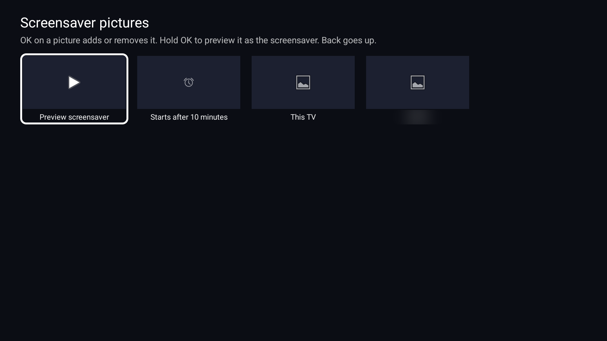

# Telugu TV Launcher

**A Telugu home screen for Android TV and Google TV.** It shows the Telugu calendar, celebrates Telugu festivals
on the right day, wishes your family on their birthdays, and turns your own photos into the screensaver. No ads,
no internet needed, and nothing to update by hand.

Built on [CleanYourTV](https://github.com/Gathin23/cleanyourtv) by Gathin23 (MIT licence). Tested on a Sony
BRAVIA VU31 (Google TV 14, 2 GB RAM).



## Features

### 📅 Telugu calendar
- Today's day and date in Telugu, beside the clock: `శనివారం, 7 నవంబర్`
- Masam, tithi and nakshatram for the day: `ఆశ్వయుజం · బహుళ త్రయోదశి · చిత్త నక్షత్రం`
- Adhika masam included.
- Calculated on the TV itself from the sun and the moon, for your own town. It keeps working year after year
  without internet or updates.

### 🪔 Festivals that come on by themselves
On a festival day the TV greets you in Telugu, the top buttons turn into a diya, a temple bell and a marigold, and
a small animation for that festival plays each time you move to an app. On normal days, the home screen stays
calm, with no animation at all.



| Festival | Animation |
|---|---|
| Bhogi, Sankranti, Kanuma | Kites |
| Ugadi | Mango leaves |
| Holi | Colours |
| Bathukamma, Saddula Bathukamma, Bonalu, Varalakshmi Vratham, Rakhi Pournami, Vasant Panchami | Flowers |
| Deepavali, Maha Shivaratri, Karthika Pournami, Akshaya Tritiya, Mukkoti Ekadashi, Ratha Saptami | Lamp sparks |
| Sri Rama Navami, Hanuman Jayanti, Toli Ekadashi, Guru Pournami, Nagula Panchami, Sri Krishnashtami, Vinayaka Chavithi, Ganesh Nimajjanam, Mahanavami, Dasara, Nagula Chavithi | Marigold petals |
| New Year (31 December and 1 January) | Confetti |

### 🎂 Family birthdays and anniversaries
Add your family's dates once. On the day, the TV wishes them in Telugu with the right age, like
`<name> 24వ పుట్టినరోజు శుభాకాంక్షలు`, with balloons for birthdays and hearts for anniversaries. The names stay
on your TV only, never in the code.

### 🏠 A cleaner home screen
- Four apps a row; keep the apps you use less further down.
- Move an app and it **swaps places** with the app it lands on, while every other app stays where it is.
- The background takes the colour of the app you are on.
- A **Settings** button that opens a quick panel (TV settings, Display, Network, Apps) instead of the full
  settings.
- A **Wi-Fi** button that turns green when online, orange with no internet, and red with a crossed-out icon
  when offline.
- 12-hour clock.

| Four apps a row | Swapping two apps |
|---|---|
|  |  |

| Colour of the selected app | Quick settings |
|---|---|
|  |  |

### 🖼️ Your photos as the screensaver
- Shows the photos already saved on the TV, and adds new ones by itself.
- Every photo is shown whole, never cut off, with a slow, gentle zoom.
- A photo button on the home screen lets you pick photos with the remote, from the TV or a USB pen drive: add one
  photo or a whole folder, preview the screensaver, and choose when it starts (1 to 10 minutes).



## What I added to CleanYourTV

[CleanYourTV](https://github.com/Gathin23/cleanyourtv) removes the ads and preloaded apps from Android TVs and
replaces the home screen with a fast, clean launcher. This project keeps all of it and adds:

| Added in this project | Files |
|---|---|
| Telugu calendar: masam, tithi, nakshatram, adhika masam | `Panchangam.java` (new) |
| Telugu festivals and New Year that switch on by themselves | `FestivalCalendar.java` (new) |
| Family birthdays and anniversaries with the right age | `FestivalCalendar.java` |
| A different animation for each festival, played once per app | `PetalShowerView.java`, `MainActivity.java` |
| Swapping two apps when moving one | `CarrySwap.java` (new) |
| A layout that keeps every app on one screen (optional) | `GridFit.java` (new) |
| Quick settings panel on the home screen's Settings button | `MainActivity.java` |
| Crossed-out Wi-Fi icon while offline | `MainActivity.java`, `ic_wifi_off.xml` (new) |
| Screensaver: photos from the TV, whole photos with a slow zoom, a photo picker for the TV and USB drives, and the start time | `addons/photo-screensaver`: `PicturesActivity.java` (new), `Media.java`, `Slides.java` |
| Tests for all of the above | `PanchangamTest`, `FestivalCalendarTest`, `CarrySwapTest`, `GridFitTest`, `GalleryTest` |

**From CleanYourTV:** removing ads and preloaded apps safely (switched off, never uninstalled, with a one-line
restore), the launcher itself, themes, the app-colour background, the glass look, the festive diya, bell and
marigold buttons, the quick settings panel, the Wi-Fi colours, and the photo screensaver add-on by JorickGU that
this project builds on.

## Install it on your TV

You need a Windows, Mac or Linux computer on the same Wi-Fi as the TV, and an Android TV or Google TV with
Android 8 or newer (Android 13 or newer for the photo screensaver's picker).

1. **Clean the TV and install the launcher.** Follow CleanYourTV's [quick start](../README.md#quick-start): it
   walks you through switching on USB debugging, finds your TV's list of ads and preloaded apps in [`examples/`](../examples), and
   installs the launcher. Building needs JDK 17 and Android SDK 34.
2. **Install the photo screensaver** (optional):
   ```
   addons\photo-screensaver\build-and-install.ps1 -TvHost <tv ip>
   ```
   Then give it its permissions from the repo folder, with `TV_HOST` set to the TV's address:
   ```
   tools\venv\Scripts\python.exe tools\tv.py "pm grant com.gathin.photodream android.permission.READ_MEDIA_IMAGES"
   tools\venv\Scripts\python.exe tools\tv.py "appops set com.gathin.photodream WRITE_SETTINGS allow"
   tools\venv\Scripts\python.exe tools\tv.py "appops set com.gathin.photodream MANAGE_EXTERNAL_STORAGE allow"
   tools\venv\Scripts\python.exe tools\tv.py "appops write-settings"
   tools\venv\Scripts\python.exe tools\tv.py "settings put secure screensaver_components com.gathin.photodream/.PhotoDream"
   ```
3. **Turn on the Telugu features.** Make a folder with a `config.json` like this, put in your town and your
   family's dates, and send it to the TV with `tools\theme.ps1 -TvHost <tv ip> <your folder>`:
   ```json
   {
     "telugu_calendar": true,
     "festival_auto": true,
     "calendar_latitude": 17.385,
     "calendar_longitude": 78.487,
     "family_days": [
       "01-15|2010|birthday|<name>",
       "06-20|1998|anniversary|<name> - <name>"
     ],
     "clock_format": "12",
     "columns": 4,
     "rows_below_dock": 3,
     "dock_row": false,
     "swap_tiles": true,
     "app_glow": true,
     "ambient_glow": true,
     "glass_style": "rim",
     "advanced_effects": true,
     "settings_pill_panel": true,
     "wifi_status_color": true,
     "wifi_status_warnings": true,
     "top_bar_apps": ["com.gathin.photodream"],
     "launch_actions": ["com.gathin.photodream=com.gathin.photodream.action.PICK"],
     "hidden_apps": ["com.gathin.photodream"]
   }
   ```
4. **Switch USB debugging off** on the TV when you are done. Everything keeps working without it.

On a Mac or Linux, use the `.sh` scripts and `tools/venv/bin/python` instead.

### Settings

| Setting | What it does |
|---|---|
| `telugu_calendar` | The Telugu date, masam, tithi and nakshatram beside the clock |
| `calendar_latitude`, `calendar_longitude` | Your town, for the calendar (Hyderabad if not set) |
| `festival_auto` | Festivals and New Year switch on by themselves |
| `family_days` | Birthdays (`"MM-dd\|birth year\|birthday\|name"`) and anniversaries (`"MM-dd\|wedding year\|anniversary\|names"`) |
| `festival_corrections` | If your calendar shows a festival on another day: `"yyyy-MM-dd\|none"` removes one, `"yyyy-MM-dd\|name\|animation"` adds one (0 petals, 1 sparks, 2 leaves, 3 kites, 4 flowers, 5 colours, 6 balloons, 7 hearts, 8 confetti) |
| `festival_preview_date` | Try out how another day will look; remove it afterwards |
| `swap_tiles` | Moving an app swaps it with the app it lands on |
| `fit_all_tiles` | Keep every app on one screen instead of scrolling |
| `dock_names` | Show the name under the selected app in the top row |
| `settings_pill_panel` | The Settings button opens the quick settings panel |

All the other settings are CleanYourTV's, listed in [`themes/README.md`](../themes/README.md).

## Good to know

- **Festival dates** follow the panchangam's rules, but a printed calendar can differ by a day now and then. If
  yours does, use `festival_corrections`.
- **The calendar is for one town.** Nearby towns get the same dates; a place far away can differ by a day.
- **A TV software update** can bring back the old home screen and the preloaded apps. Run CleanYourTV's
  `tools\check.py --fix` again, and give the photo screensaver its permissions again.
- **Volume:** on the Sony BRAVIA VU31 the TV draws its own volume bar, so it cannot be restyled there.
- **Festival days** use a little more processing while the home screen is open, for the diya's flickering flame.
- **The launcher is about 583 KB.** CleanYourTV keeps its launcher under 576 KB; this project allows 600 KB for
  the Telugu features.
- The Wi-Fi icon's offline look has not yet been seen on a real TV while offline.

## Use at your own risk

This changes the software on your TV. Apps are only switched off, never uninstalled, and CleanYourTV's restore
script puts them back, but every TV is different and this comes with no warranty. Changing your TV's software may
affect its warranty or support. Read CleanYourTV's [safety notes](../README.md#questions-people-ask) first, and
keep the restore command it gives you.

## Credits

- [CleanYourTV](https://github.com/Gathin23/cleanyourtv) by Gathin23 and its contributors, MIT licence. Its own
  guide is in [README.md](../README.md).
- The photo screensaver add-on by JorickGU, with the prints style from Photo Prints by shivamsingh262.
- Astronomy after Jean Meeus, *Astronomical Algorithms*.

This project is not affiliated with Sony, Google or CleanYourTV. MIT licence, as the original.
